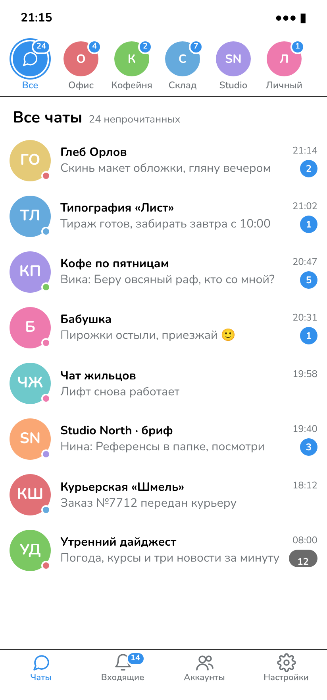
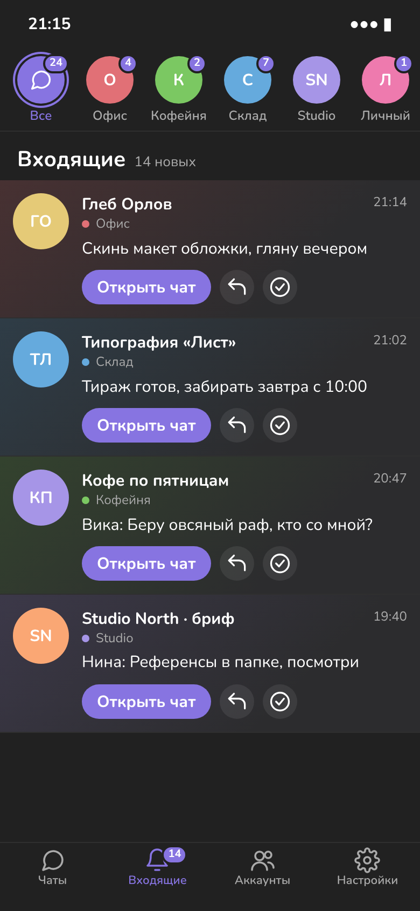
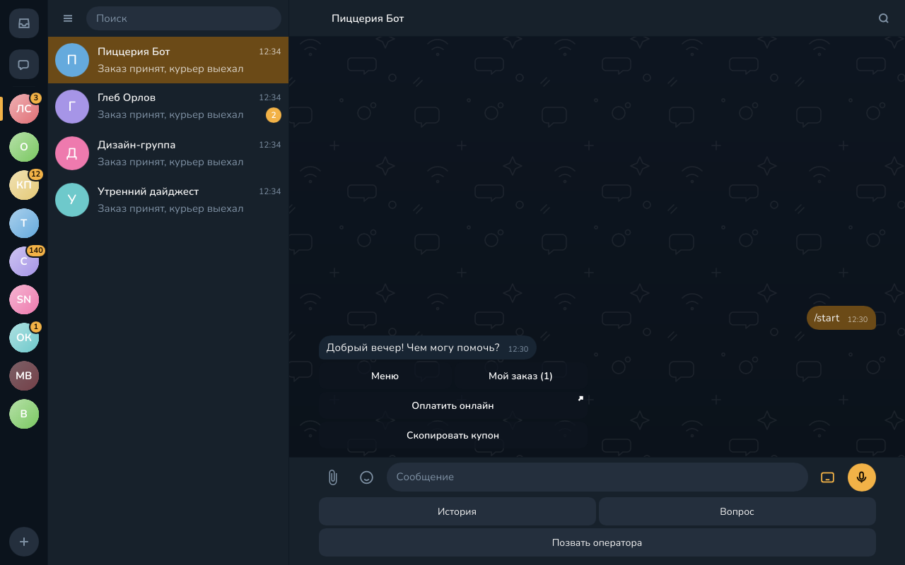

<h1 align="center">Hivogram: сборки</h1>

Готовые сборки Hivogram и Hivogram Lite. Исходники в приватном `alltginone`, здесь только workflow и [Releases](https://github.com/chvdbhcx-del/hivogram-builds/releases).

| Android | iPhone | Hivogram Lite |
|---|---|---|
|  |  |  |

## Файлы

| Платформа | Где |
|---|---|
| Windows 10/11 | `Hivogram-…-windows-x64-setup.exe` в Releases |
| Android 7+ | `Hivogram-…-android.apk` в Releases |
| iPhone, браузер | <https://hivogram.pages.dev> |
| Windows, Hivogram Lite | `hivogram-lite-windows-x64-…-setup.exe` в Releases |

Сборки без цифровой подписи, SmartScreen может предупредить.

## Структура

Репозиторий публичный ради бесплатных минут GitHub Actions. Исходники забираются по секрету `SOURCE_TOKEN`.

| Workflow | Что делает |
|---|---|
| [Hivogram](https://github.com/chvdbhcx-del/hivogram-builds/actions/workflows/hivogram.yml) | Windows `.exe` + Android `.apk` в Releases, веб-приложение на hivogram.pages.dev |
| [Hivogram Lite](https://github.com/chvdbhcx-del/hivogram-builds/actions/workflows/lite.yml) | лёгкая Windows-версия на Rust, `.exe` в Releases |
| [Publish a run](https://github.com/chvdbhcx-del/hivogram-builds/actions/workflows/publish-run.yml) | выкладывает в Releases файлы уже прошедшего прогона Hivogram |

Запуск: Actions → workflow → Run workflow, там же можно выбрать ветку исходников.

### Секреты (Settings → Secrets and variables → Actions)

| Секрет | Зачем |
|---|---|
| `SOURCE_TOKEN` | fine-grained токен GitHub: доступ к приватному `alltginone` (там и Hivogram, и Hivogram Lite в `lite/`), Contents: Read-only |
| `TELEGRAM_API_ID`, `TELEGRAM_API_HASH` | ключи Hivogram, вшиваются во все сборки |
| `CLOUDFLARE_API_TOKEN` | заливка на Cloudflare Pages (токен с шаблона «Edit Cloudflare Workers») |
| `VAPID_KEY` | необязательно: Web Push-ключ Telegram, иначе берётся с web.telegram.org/a |
| `ANDROID_KEYSTORE_BASE64` | необязательно: base64 ключа подписи APK. Подходит `debug.keystore` с ПК (пароль и алиас по умолчанию `android` / `androiddebugkey`), тогда APK ставится поверх старого |
| `ANDROID_KEYSTORE_PASSWORD`, `ANDROID_KEY_ALIAS`, `ANDROID_KEY_PASSWORD` | только для своего `.jks` |
