

<h1 align="center">Hivogram</h1>

<b>Все ваши Telegram-аккаунты в одном окне.</b> 
10, 30, 60 аккаунтов: одна лента сообщений, один список чатов, рассылки по расписанию и инструменты для работы с клиентами.

<a href="#скачать"><b>Скачать: Windows, Android, iPhone</b></a>

## Скачать

Все версии в одном месте, ссылки ведут на самую свежую сборку и обновляются сами после каждой сборки.

<!-- downloads:start -->
| | Что | Файл | Версия | Дата |
|---|---|---|---|---|
| **WEBA** | Windows 10/11, основная версия | [Скачать](https://github.com/chvdbhcx-del/hivogram-builds/releases/latest/download/Hivogram-WEBA-0.2.0-build.24-setup.exe) | 0.2.0, сборка 24 | 20.11.2026 |
| **APK** | Android 7+ | [Скачать](https://github.com/chvdbhcx-del/hivogram-builds/releases/latest/download/Hivogram-APK-0.2.0-build.24.apk) | 0.2.0, сборка 24 | 20.11.2026 |
| **сайт** | iPhone и браузер | [Открыть](https://hivogram.pages.dev) | всегда свежий | |
| **UNI** | Windows 10/11, версия на Unigram | [Скачать](https://github.com/chvdbhcx-del/hivogram-builds/releases/latest/download/Hivogram-UNI-13.2.2-build.2-x64.msixbundle) · [сертификат](https://github.com/chvdbhcx-del/hivogram-builds/releases/latest/download/Hivogram-UNI.cer) | 13.2.2, сборка 2 | 20.11.2026 |
| **Rust** | Windows, лёгкая версия для слабых ПК | [Скачать](https://github.com/chvdbhcx-del/hivogram-builds/releases/latest/download/Hivogram-Rust-0.3.0-build.12-setup.exe) | 0.3.0, сборка 12 | 20.11.2026 |
<!-- downloads:end -->

- **WEBA** — основная версия для Windows. Если SmartScreen ругается: «Подробнее» → «Выполнить в любом случае».
- **APK** — Android, работает в фоне и не теряет уведомления.
- **сайт** — iPhone: открыть в Safari → «Поделиться» → «На экран „Домой“».
- **UNI** — та же идея на движке Unigram. Один раз поставь сертификат: открыть `.cer` → «Установить сертификат» → «Локальный компьютер» → «Поместить все сертификаты в следующее хранилище» → «Доверенные лица». Потом двойной клик по `.msixbundle`.
- **Rust** — Hivogram Lite, отдельный лёгкий клиент, в разы меньше памяти.

Дальше все версии обновляются сами. Старые сборки: [все релизы](https://github.com/chvdbhcx-del/hivogram-builds/releases).

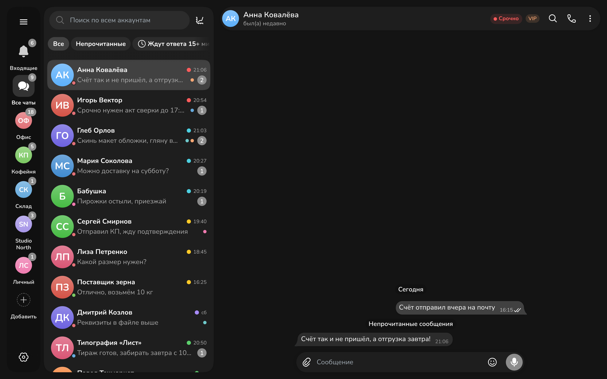

<table>
<tr>
<td width="50%" align="center" valign="top"><b>«Входящие»</b> 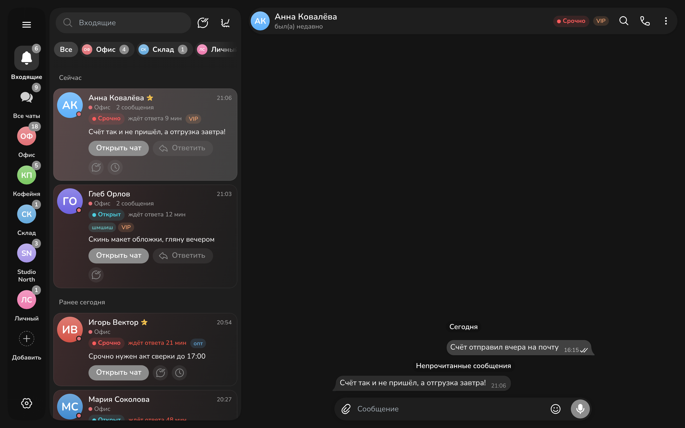</td>
<td width="50%" align="center" valign="top"><b>Рассылки</b> 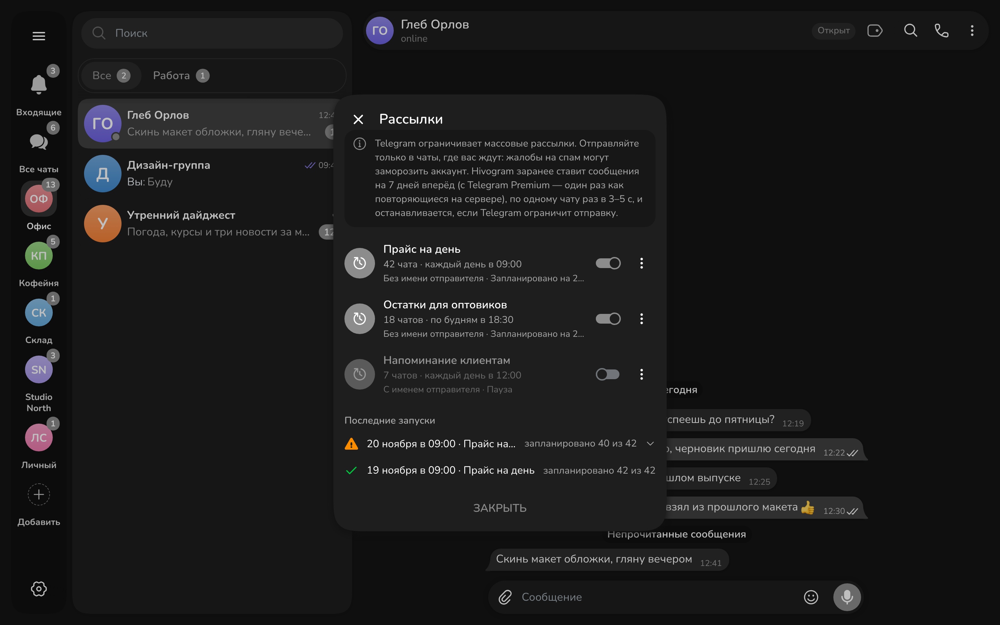</td>
</tr>
<tr>
<td width="50%" align="center" valign="top"><b>Звонок на другой аккаунт</b> 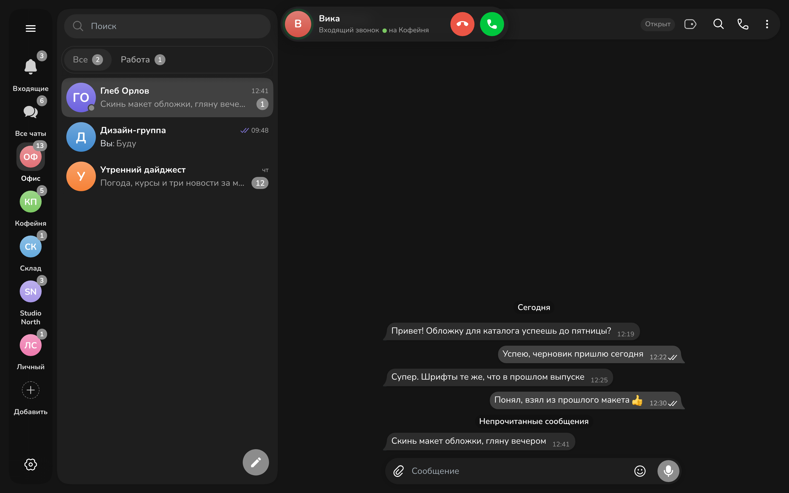</td>
<td width="50%" align="center" valign="top"><b>Настройки</b> 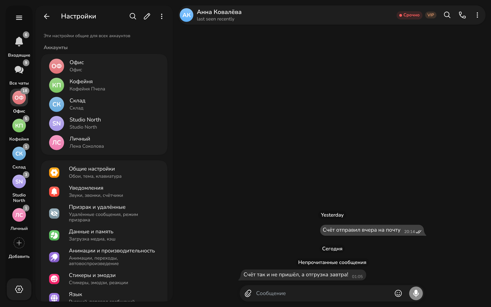</td>
</tr>
</table>

<table>
<tr>
<td width="25%" align="center" valign="top"><b>Android, чаты</b> 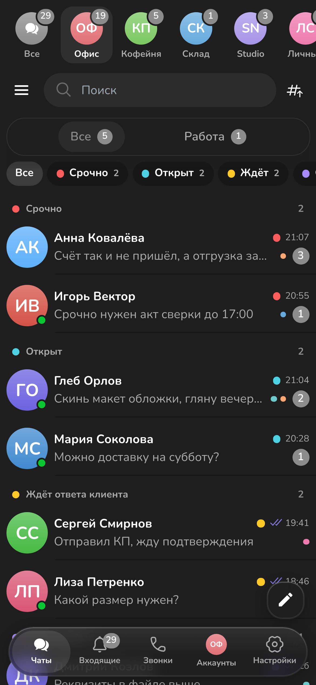</td>
<td width="25%" align="center" valign="top"><b>Android, «Входящие»</b> 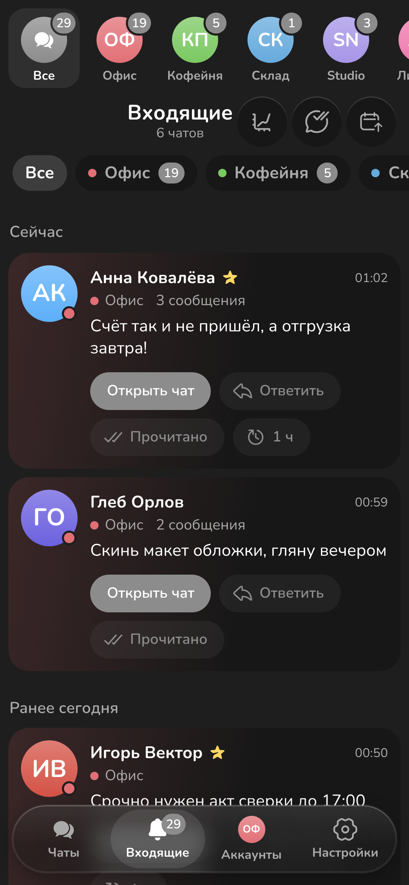</td>
<td width="25%" align="center" valign="top"><b>iPhone, все чаты</b> 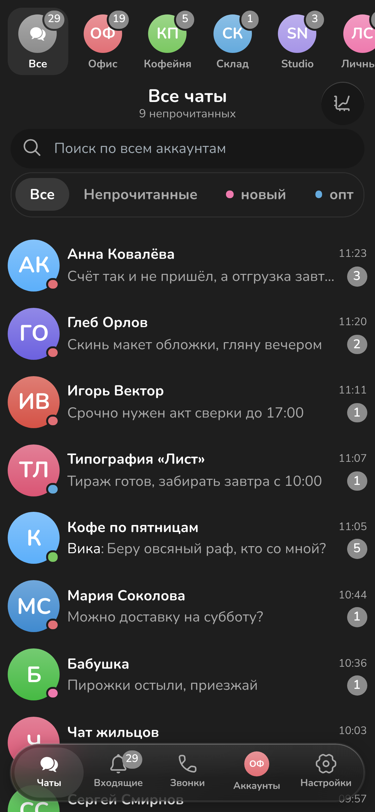</td>
<td width="25%" align="center" valign="top"><b>iPhone, чат</b> 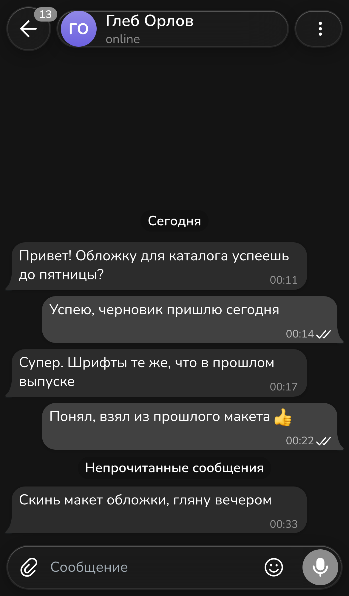</td>
</tr>
</table>

Скриншоты в демо-режиме, аккаунты и чаты выдуманные. ПК: окно 1440×900. Телефон: экран 390×844.

## Кому это нужно

Тем, кто ведёт много аккаунтов сразу: продажи и поддержка, агентства и SMM, магазины, арбитраж, менеджеры сообществ. Вместо десятка окон Telegram Desktop, бесконечного переключения и пропущенных сообщений — одно приложение, где видно всё и сразу.

Внутри настоящий Telegram: чаты, файлы, голосовые, кружки, стикеры, боты, папки, профили работают как в обычном клиенте, выглядят так же и с теми же анимациями. Ключи Telegram уже встроены: установил, вошёл по QR-коду или номеру, работаешь.

## Мультиаккаунт: как это работает

### Рейл аккаунтов

Слева полоса со всеми аккаунтами: аватар, подпись, свой цвет и счётчик непрочитанных. Клик переключает аккаунт мгновенно, `Ctrl+1…9` открывает нужный сразу, `Ctrl+Tab` листает аккаунты, начиная с последнего использованного. Наведи на плитку и увидишь, сколько чатов ждут ответа и какое у аккаунта среднее время ответа.

### «Входящие»

Все новые сообщения со всех аккаунтов падают в одну ленту. Каждая карточка подписана аккаунтом и чатом, ответить можно прямо с неё, не открывая чат. Можно отметить прочитанным или отложить на час. Лишнее отсекается правилами: замьюченные чаты, каналы, группы без упоминания, ключевые слова.

Когда окно свёрнуто, новые сообщения всплывают окошком в стиле Telegram Desktop с быстрым ответом. Общий счётчик непрочитанных виден на значке в панели задач и в трее.

### «Все чаты»: один список на все аккаунты

Чаты всех аккаунтов в одном списке по времени. Слева список, справа открытый чат, как в обычном Telegram. Чат открывается в своём аккаунте, так что ответы, медиа и профиль собеседника работают полностью. Сверху фильтры по аккаунтам, меткам, статусам и «Ждут ответа дольше N минут».

### Поиск сразу по всем аккаунтам

Один запрос ищет чаты и сообщения во всех аккаунтах, результаты сгруппированы по аккаунтам. Клик открывает нужный аккаунт, чат и сообщение.

### Аккаунты не мешают друг другу

У каждого аккаунта на Windows своё отдельное хранилище и свой процесс, как будто это разные браузеры. Аккаунты не видят данных друг друга, а если один подвис, остальные работают дальше. Для каждого аккаунта можно задать свой SOCKS5 или HTTP-прокси, и такой аккаунт никогда не выйдет в сеть напрямую.

### Спящий режим: 60 аккаунтов без тормозов

Каждый открытый аккаунт занимает память, и на 50 аккаунтах обычный клиент встаёт колом. Hivogram усыпляет аккаунты, которыми вы сейчас не пользуетесь: выгружает их из памяти, но помнит чаты и счётчики, поэтому в списках они выглядят как обычно.

- Открытый аккаунт, 5 последних и отмеченные «Не усыплять» не спят никогда.
- Раз в 5 минут спящие по очереди просыпаются, забирают новое и засыпают снова. Всё пришедшее попадает во «Входящие», с одним уведомлением на аккаунт.
- Открыли спящий аккаунт или ответили из ленты — он просыпается сразу.
- На Windows можно включить мгновенные уведомления спящих: о новом сообщении становится известно сразу, без ожидания проверки.

Всё настраивается, режим можно выключить совсем.

### Группы аккаунтов

Разложите аккаунты по группам: «Продажи», «Поддержка», «Личное». Переключатель групп оставляет в рейле, ленте и списке чатов только нужные аккаунты. У каждой группы могут быть свои уведомления, звук и тихие часы по дням недели.

### Настройки

Тема, язык, шрифт, анимации и уведомления меняются один раз и сразу во всех аккаунтах. Ниже список аккаунтов, и у каждого свои телеграмные настройки: профиль, приватность, папки, сессии. Интерфейс на русском, украинском и английском.

## Звонки на всех аккаунтах

Голосовые и видеозвонки работают на каждом аккаунте, а не только на открытом. Звонят на «Кофейню», а у вас на экране «Офис»: сверху появляется карточка «Вика · Входящий звонок на Кофейня» с двумя кнопками, «Ответить» и «Отклонить». Ответили — Hivogram сам переключается на нужный аккаунт и открывает звонок.

- **Экран звонка как в современном Telegram:** большая аватарка, живой градиентный фон и полупрозрачные кнопки.
- **Звонок не теряется.** Свернули звонок или ушли в другой аккаунт — сверху остаётся зелёная полоска с собеседником и таймером. Тап по ней возвращает в звонок, кнопка справа завершает.
- **Один разговор за раз.** Приняли звонок на другом аккаунте — текущий завершается сам, как в Telegram.
- **Аккаунт со звонком не засыпает,** а экран телефона не гаснет, пока идёт разговор.

<table>
<tr>
<td width="25%" align="center" valign="top"><b>На другой аккаунт</b> 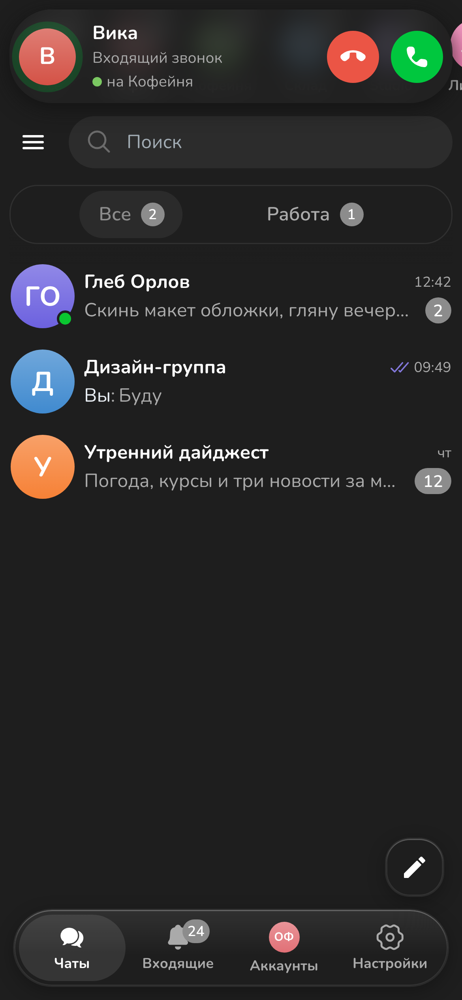</td>
<td width="25%" align="center" valign="top"><b>Входящий</b> 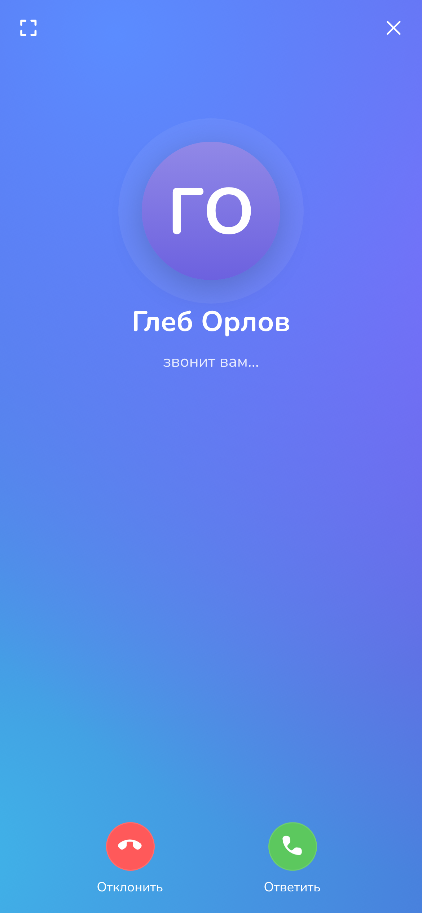</td>
<td width="25%" align="center" valign="top"><b>Разговор</b> 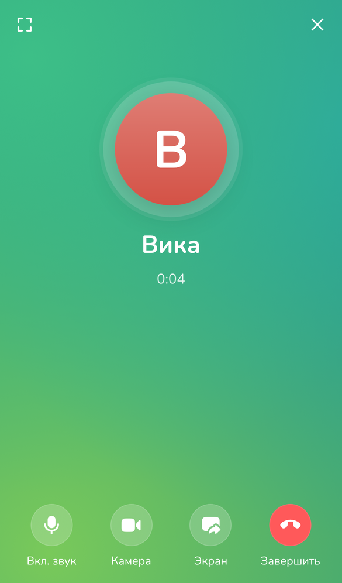</td>
<td width="25%" align="center" valign="top"><b>Полоска звонка</b> 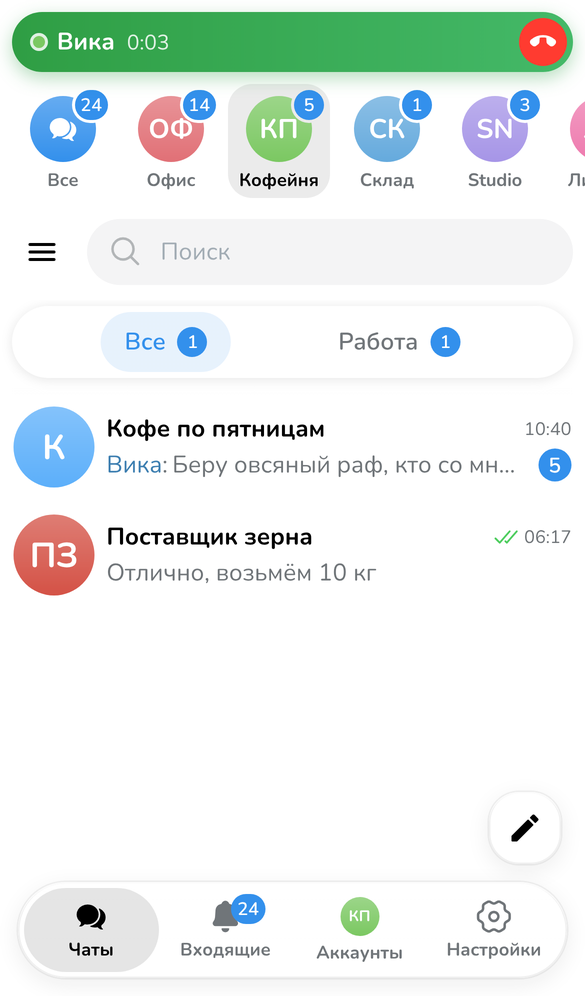</td>
</tr>
</table>

Звонят только загруженные аккаунты: спящий в лучшем случае пришлёт уведомление. На iPhone звонок слышно, пока Hivogram открыт: из фона и с закрытым приложением iOS сайтам звонить не даёт.

## Инструменты для работы с клиентами

- **Шаблоны ответов.** Общая библиотека готовых ответов на все аккаунты или только на выбранные. Набрал `/` в поле ввода, выбрал шаблон. Подставляются имя собеседника, аккаунт, дата и время. Любое сообщение можно сохранить как шаблон.
- **Метки и заметки.** Цветные ярлыки на любых чатах («VIP», «Оплачено», «Новый») и заметка в профиле собеседника. Видны только вам, по меткам можно фильтровать.
- **Статусы переписки.** «Открыт», «Ждёт ответа клиента», «Готово». Ставятся сами: написал клиент — «Открыт», ответили вы — «Ждёт ответа». Закрытые чаты уходят из основной ленты.
- **Напоминания.** «Напомнить через 30 минут, час, завтра в 9:00» — чат всплывёт снова в нужный момент.
- **Время ответа.** На карточке видно, сколько клиент уже ждёт, просроченные подсвечены красным. В настройках статистика по каждому аккаунту за неделю.
- **Массовые действия.** «Прочитать всё» и «Архивировать всё» для аккаунта или папки в один клик.
- **Telegram Business пачкой.** Часы работы, приветствие и автоответ «нет на месте» задаются сразу для всех выбранных Premium-аккаунтов.
- **Перевод без Premium.** Перевод сообщений и целых чатов, можно подключить свой DeepL, Google или LibreTranslate.
- **ИИ-помощник** (включается по желанию). «Черновик ответа» пишет вариант ответа в поле ввода, «Кратко о чате» пересказывает длинную переписку. Работает с вашим ключом, отправка только по клику.

## Рассылки по расписанию

Нужно каждый день в 10:00 переслать одно сообщение в 40+ чатов, без имени отправителя и без ручного выбора чатов? Это делается один раз.

1. **Наборы чатов.** Выделите чаты в окне пересылки и сохраните их как набор. Или соберите набор из папки Telegram одним кликом. Дальше весь набор выбирается одним нажатием.
2. **Разовая рассылка.** Выбрали набор, поставили «Без имени отправителя», отправили сейчас или позже.
3. **Ежедневная рассылка.** Нажали «Каждый день» и выбрали время. Можно каждый день или только по будням, без звука, без имени отправителя. Все задания и их история собраны в окне «Рассылки».

**Работает, даже когда компьютер выключен.** Hivogram закладывает сообщения в отложенные Telegram на 7 дней вперёд, и отправляет их уже сам Telegram по расписанию. Достаточно запускать Hivogram хотя бы раз в неделю. С Telegram Premium рассылка ставится повторяющейся прямо на сервере Telegram, и после этого идёт сама, приложение можно не открывать вообще.

**Бережёт аккаунт от бана.** Сообщения уходят по одному чату с паузой 3–5 секунд, а не пачкой. Если Telegram просит подождать, Hivogram ждёт и продолжает. Если Telegram начинает считать аккаунт спамером, рассылка сама останавливается и объясняет, что случилось. Прерванная отправка продолжается с того же места, без дублей. История показывает по каждому чату, дошло сообщение или нет, и почему.

## Приватность и безопасность

- **Пароль на приложение.** При запуске и после N минут простоя Hivogram закрывается экраном блокировки, уведомления приходят без текста.
- **Скрытые аккаунты.** Отдельный пароль открывает аккаунты, которых без него не видно нигде: ни в рейле, ни в списках, ни в счётчиках.
- **Режим призрака** (на ваш страх и риск, по умолчанию выключен). Читать чаты без отметки о прочтении, всегда быть «не в сети», не показывать «печатает…», смотреть истории незаметно. Для всех аккаунтов сразу или для каждого отдельно.
- **Удалённые и изменённые сообщения.** Если собеседник удалил сообщение, оно остаётся у вас с пометкой «удалено». У отредактированного видна прежняя версия. Всё собрано в меню чата «Удалённые и изменённые».
- **Подписанные обновления.** Приложение само проверяет обновления и ставит только те, что подписаны ключом Hivogram.

## Лицензия

GPL-3.0-or-later. Hivogram Lite — MIT.
